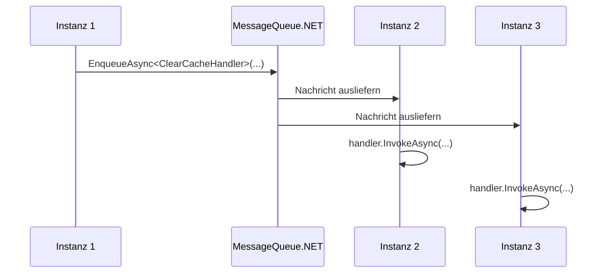

# App-Topic-Pattern

Läuft eine Anwendung in mehreren Instanzen (z. B. in Kubernetes), müssen manche Aktionen **alle** Instanzen
erreichen, etwa das Leeren eines In-Memory-Caches. Beim App-Topic-Pattern bekommt jede Instanz ihre eigene Queue,
und eine Nachricht wird in die Queues aller Instanzen eingereiht.



## Einrichtung

```json title="appsettings.json"
{
  "MessageQueue": {
    "ConnectionString": "http://localhost:9091",
    "Namespace": "production"
  }
}
```

```csharp title="Program.cs"
using MessageQueueNET.Client.Extensions.DependencyInjetion;

builder.Services
    .AddMessageQueueClientService()
    .AddMessageQueueAppTopicServices(config =>
    {
        config.MessageQueueApiUrl = builder.Configuration["MessageQueue:ConnectionString"] ?? "";
        config.MessageQueueClientId = builder.Configuration["MessageQueue:ClientId"] ?? "";         // (1)!
        config.MessageQueueClientSecret = builder.Configuration["MessageQueue:ClientSecret"] ?? "";
        config.MaxPollingSeconds = 20; // (2)!

        config.AppName = "my-app-name";
        config.Namespace = builder.Configuration["MessageQueue:Namespace"] ?? ""; // (3)!

        config.QueueLifetimeSeconds = 120;     // optional
        config.ItemLifetimeSeconds = 120;      // optional
        config.ManageQueueLifetimeCycle = true; // default
    })
    .AddMessageHandler<ClearInMemoryCacheMessageHandler>();
```

1. Optional, nur wenn die [Autorisierung](../api/configuration.md#autorisierung) aktiviert ist.
2. Maximale Zeit, die eine Long-Polling-Anfrage auf neue Nachrichten wartet, bevor eine neue Anfrage startet.
3. Optional, aber empfohlen, wenn sich Entwicklungs-, Test- und Produktionsinstanzen einen MessageQueue.NET-Server teilen.

Beim Start legt jede Instanz ihre eigene Queue an:

```text
production.my-app-name3f2a9c1e0b7d4e6f8a5b2c4d6e8f0a1b   // {Namespace}.{AppName}{instance id}
```

Die Instanzen unterscheiden sich nur in der Instanz-Id.

## Message Handler

Ein Message Handler implementiert `IMessageHandler` und wird mit `AddMessageHandler<T>()` registriert:

```csharp title="ClearInMemoryCacheMessageHandler.cs"
[MessageHandler(CommandName = CommandName)] // (1)!
internal class ClearInMemoryCacheMessageHandler(
        IMyCache myCache,
        ILogger<ClearInMemoryCacheMessageHandler> logger) : IMessageHandler
{
    public const string CommandName = "ClearInMemCache";

    public Task InvokeAsync(string message)
    {
        try
        {
            myCache.Clear();
        }
        catch (Exception ex)
        {
            logger.LogWarning("Exception: {exceptionMessage}", ex.Message);
        }

        return Task.CompletedTask;
    }
}
```

1. Optional. Ohne das Attribut ist der Befehlsname der Klassenname. Nur Buchstaben und Ziffern verwenden.

Ein Hintergrunddienst wartet auf Nachrichten im Format `{command}:{message}` und ruft `InvokeAsync(message)` des
passenden Handlers auf.

## Nachrichten senden

Mit dem `MessageQueueAppTopicService` eine Nachricht an alle Instanzen schicken:

```csharp
class MyService(MessageQueueAppTopicService topicService)
{
    public Task ClearAllCaches()
        => topicService.EnqueueAsync<ClearInMemoryCacheMessageHandler>(
                ["please clear the cache"],
                includeOwnQueue: true); // (1)!
}
```

1. `true`: Auch die aktuelle Instanz bekommt die Nachricht.

Die Nachricht wird in alle Queues eingereiht, die zu `{Namespace}.{AppName}*` passen, z. B. `production.my-app-name*`.
