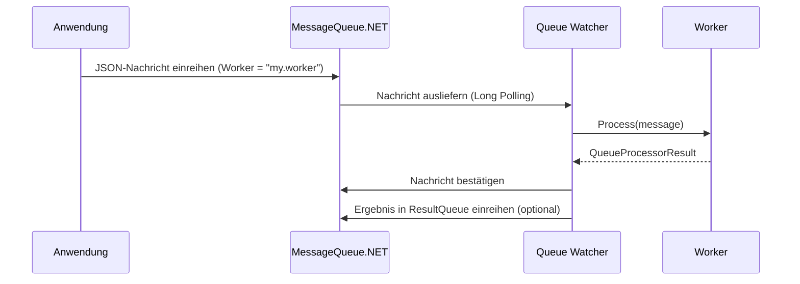

# Queue-Worker-Pattern

Mit dem Queue-Worker-Pattern beobachtet eine Anwendung eine oder mehrere Queues und übergibt jede Nachricht an
einen passenden **Worker**. Nachrichten sind JSON-Objekte; das Feld `Worker` entscheidet, welcher Worker die
Nachricht verarbeitet. Ein Worker kann sein Ergebnis in eine *Result Queue* schreiben, wo es der nächste Worker abholt.



## Nachrichten

Jede Nachricht basiert auf `BaseQueueProcessorMessage`:

```csharp
public class BaseQueueProcessorMessage
{
    public string ProcessId { get; set; } = "";
    public string Worker { get; set; } = "";       // (1)!
    public string? ResultQueue { get; set; }      // (2)!
    public string? Publisher { get; set; }
    public string? Subject { get; set; }
}
```

1. Die `WorkerId` des Workers, der die Nachricht verarbeitet.
2. Optional: Das Ergebnis des Workers wird in diese Queue geschrieben.

`GenericQueueProcessorMessage<T>` ergänzt einen typisierten `Body`.

## Worker

Ein Worker implementiert `IQueueProcessor`:

```csharp
public interface IQueueProcessor
{
    string WorkerId { get; }
    bool ConfirmAlways { get; } // (1)!
}
```

1. `true`: Die Nachricht wird nach der Verarbeitung bestätigt, auch wenn der Worker fehlschlägt.

Es gibt zwei Arten von Workern:

=== "Nicht generisch"

    ```csharp
    public interface INonGenericQueueProcessor : IQueueProcessor
    {
        Task<QueueProcessorResult> Process(
            BaseQueueProcessorMessage jobProcessMessage,
            CancellationToken cancellationToken);
    }
    ```

=== "Generisch"

    ```csharp
    public interface IGenericQueueProcessor<T> : IQueueProcessor where T : new()
    {
        Task<QueueProcessorResult> ProcessGeneric(
            GenericQueueProcessorMessage<T> message,
            CancellationToken cancellationToken);
    }
    ```

## Einrichtung

Client-Service und Queue Watcher registrieren:

```csharp title="Program.cs"
using MessageQueueNET.Client.Extensions.DependencyInjetion;

builder.Services
    .AddMessageQueueClientService()
    .AddQueueProcessorWatcher(config =>
    {
        config.MessageQueueApiUrl = "https://localhost:5001";
        config.QueueNameFilter = "mq-processor.jobs"; // (1)!
    });
```

1. Eine Queue (`my-queue`), ein Muster (`my-queues.*`) oder mehrere Muster (`my-queues.*,our-queues.*`).

Weitere Optionen: `MessageQueueClientId`, `MessageQueueClientSecret`, `MaxPollingSeconds` und `TryRegisterQueues`.

### Test mit dem Ping-Worker

`AddQueueProcessorWatcher` fügt den `PingWorker` (`mq.ping`) hinzu. Er schreibt sein Ergebnis nach
`ping.response.{ResultQueue}`. Testen mit [mqnet](../tools.md#shell):

```text
mqnet https://localhost:5001 -c shell
>> mq-processor.jobs enqueue -ping -m 1
```


## Eigene Worker

Ein Body-Modell und bei Bedarf ein Ergebnis-Modell definieren:

```csharp
public class CommandLineWorkerMessage
{
    public string Command { get; set; } = "";
    public string Arguments { get; set; } = "";
}

public class CommandLineWorkerResultBody
{
    public int ExitCode { get; set; }
    public string? Output { get; set; }
    public string? ErrorOutput { get; set; }
}
```

Den Worker implementieren:

```csharp title="CommandLineWorker.cs"
public class CommandLineWorker : IGenericQueueProcessor<CommandLineWorkerMessage>
{
    public const string WorkerIdentifier = "mq.commandline";

    public string WorkerId => WorkerIdentifier;

    public bool ConfirmAlways => true;

    public async Task<QueueProcessorResult> ProcessGeneric(
            GenericQueueProcessorMessage<CommandLineWorkerMessage> message,
            CancellationToken cancellationToken)
    {
        try
        {
            // Geschäftslogik ...

            return new GenericQueueProcessorResult<CommandLineWorkerResultBody>() // (1)!
            {
                Worker = "mq-commandline.result.file",
                Body = new CommandLineWorkerResultBody()
                {
                    ExitCode = 0,
                    Output = "..."
                }
            };
        }
        catch (Exception ex)
        {
            return new QueueProcessorResult()
            {
                Succeeded = false,
                ErrorMessages = ex.ToString()
            };
        }
    }
}
```

1. Hat die Nachricht eine `ResultQueue`, wird dieses Ergebnis dort als Nachricht für den Worker
   `mq-commandline.result.file` eingereiht.

Den Worker registrieren:

```csharp title="Program.cs"
builder.Services.AddTransient<IQueueProcessor, CommandLineWorker>();
```

## Worker-Nachrichten senden

Die Nachricht serialisieren und mit dem [Client](../client.md) einreihen:

=== "Basis-Nachricht"

    ```csharp
    var message = new BaseQueueProcessorMessage()
    {
        ProcessId = Guid.NewGuid().ToString(),
        Worker = "mq.ping",
        ResultQueue = "mq-processor.jobs",  // optional
        Subject = "ping",                   // optional
        Publisher = Environment.UserName    // optional
    };

    await client.EnqueueAsync([JsonSerializer.Serialize(message)]);
    ```

=== "Generische Nachricht"

    ```csharp
    var message = new GenericQueueProcessorMessage<CommandLineWorkerMessage>()
    {
        ProcessId = Guid.NewGuid().ToString(),
        Worker = CommandLineWorker.WorkerIdentifier,
        ResultQueue = "mq-processor.jobs.results",
        Publisher = Environment.UserName,
        Body = new()
        {
            Command = @"c:\temp\test.bat",
            Arguments = "123"
        }
    };

    await client.EnqueueAsync([JsonSerializer.Serialize(message)]);
    ```
