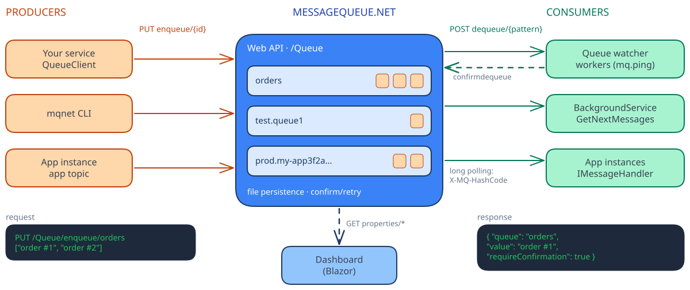

# MessageQueue.NET

**MessageQueue.NET** is a lightweight message queue with a REST API, written in C# on **.NET 10**.
Senders and receivers never talk to each other directly: a message is stored in a queue until a receiver
picks it up, and every message is processed by exactly one receiver.

-   :material-api:{ .lg .middle } **Web API**

    ---

    Create queues by name, enqueue and dequeue messages, long polling, confirmations and limits.

    [:octicons-arrow-right-24: REST reference](api/rest.md)

-   :material-language-csharp:{ .lg .middle } **.NET client**

    ---

    `MessageQueueNET.Client` wraps the REST API and adds worker and app topic patterns.

    [:octicons-arrow-right-24: Client library](client.md)

-   :material-console:{ .lg .middle } **Command line tools**

    ---

    `mqnet` shell to inspect and fill queues, `MessageQueueNET.Processor` to run commands from a queue.

    [:octicons-arrow-right-24: Tools](tools.md)

-   :material-monitor-dashboard:{ .lg .middle } **Dashboard**

    ---

    Blazor dashboard to watch queues, browse messages and manage queue properties.

    [:octicons-arrow-right-24: Installation](installation.md)

## Overview

{ .mq-diagram }

- **Producers** (applications, the command line tool) put messages into named queues.
- **MessageQueue.NET** keeps the queues in memory and optionally persists them to the file system.
- **Consumers** (workers, app instances, the processor) pick messages up. With a *confirmation period*,
  a message that is not confirmed in time goes back into the queue.
- The **dashboard** shows the state of one or more MessageQueue.NET servers.

## Features

- Any number of queues, addressed by name or by pattern (`orders.*`, `queue1,queue2`)
- **Long polling**: consumers wait for new messages instead of polling in a loop
- **Confirmations**: messages are re-queued if processing is not confirmed in time
- Queue and message lifetimes, suspend enqueue/dequeue, limits against resource exhaustion
- In-memory queues with optional **file system persistence**
- **Basic authentication** with the roles `read`, `write` and `admin`
- OpenAPI description and [Scalar](https://github.com/scalar/scalar) UI
- Docker images, ZIP packages, NuGet packages, a .NET tool and an [Aspire](https://aspire.dev) integration

## Packages

| Package | Description |
|---|---|
| [`MessageQueueNET.Client`](https://www.nuget.org/packages/MessageQueueNET.Client/) | .NET client, queue worker and app topic services |
| [`MessageQueueNET.Core`](https://www.nuget.org/packages/MessageQueueNET.Core/) | Shared models and abstractions |
| [`MessageQueueNET.Worker`](https://www.nuget.org/packages/MessageQueueNET.Worker/) | Ready-made command line workers (used by `MessageQueueNET.Processor`) |
| [`MessageQueueNET.Aspire.Hosting`](https://www.nuget.org/packages/MessageQueueNET.Aspire.Hosting/) | Aspire resources for the server and the dashboard |
| [`MessageQueueNET.Cmd`](https://www.nuget.org/packages/MessageQueueNET.Cmd/) | .NET tool `mqnet` |
| `ghcr.io/jugstalt/messagequeue-net` | Docker image of the REST API |
| `ghcr.io/jugstalt/messagequeue-net-dashboard` | Docker image of the dashboard |

## Next steps

1. [Install](installation.md) the server and the dashboard.
2. [Configure](api/configuration.md) persistence, limits and authentication.
3. Use the [REST API](api/rest.md) or the [.NET client](client.md).
4. Build workers with the [queue worker pattern](patterns/queue-worker.md) or keep app instances in sync
   with the [app topic pattern](patterns/app-topic.md).
