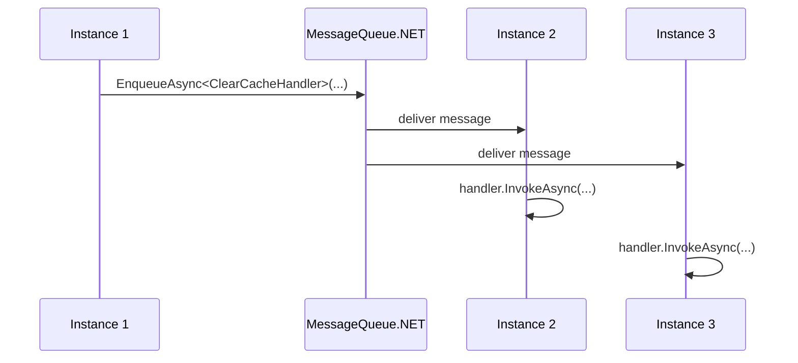

# App topic pattern

When an application runs in several instances (e.g. in Kubernetes), some actions must reach **all** instances,
for example clearing an in-memory cache. With the app topic pattern, every instance gets its own queue, and a
message is enqueued into the queues of all instances.



## Setup

```json title="appsettings.json"
{
  "MessageQueue": {
    "ConnectionString": "http://localhost:9091",
    "Namespace": "production"
  }
}
```

```csharp title="Program.cs"
using MessageQueueNET.Client.Extensions.DependencyInjetion;

builder.Services
    .AddMessageQueueClientService()
    .AddMessageQueueAppTopicServices(config =>
    {
        config.MessageQueueApiUrl = builder.Configuration["MessageQueue:ConnectionString"] ?? "";
        config.MessageQueueClientId = builder.Configuration["MessageQueue:ClientId"] ?? "";         // (1)!
        config.MessageQueueClientSecret = builder.Configuration["MessageQueue:ClientSecret"] ?? "";
        config.MaxPollingSeconds = 20; // (2)!

        config.AppName = "my-app-name";
        config.Namespace = builder.Configuration["MessageQueue:Namespace"] ?? ""; // (3)!

        config.QueueLifetimeSeconds = 120;     // optional
        config.ItemLifetimeSeconds = 120;      // optional
        config.ManageQueueLifetimeCycle = true; // default
    })
    .AddMessageHandler<ClearInMemoryCacheMessageHandler>();
```

1. Optional, only if [authorization](../api/configuration.md#authorization) is enabled.
2. Maximum time a long polling request waits for new messages before a new request is started.
3. Optional, but recommended if development, test and production instances share one MessageQueue.NET server.

On startup, every instance creates its own queue:

```text
production.my-app-name3f2a9c1e0b7d4e6f8a5b2c4d6e8f0a1b   // {Namespace}.{AppName}{instance id}
```

The instances only differ in the instance id.

## Message handlers

A message handler implements `IMessageHandler` and is registered with `AddMessageHandler<T>()`:

```csharp title="ClearInMemoryCacheMessageHandler.cs"
[MessageHandler(CommandName = CommandName)] // (1)!
internal class ClearInMemoryCacheMessageHandler(
        IMyCache myCache,
        ILogger<ClearInMemoryCacheMessageHandler> logger) : IMessageHandler
{
    public const string CommandName = "ClearInMemCache";

    public Task InvokeAsync(string message)
    {
        try
        {
            myCache.Clear();
        }
        catch (Exception ex)
        {
            logger.LogWarning("Exception: {exceptionMessage}", ex.Message);
        }

        return Task.CompletedTask;
    }
}
```

1. Optional. Without the attribute, the command name is the class name. Use only letters and digits.

A background service waits for messages in the format `{command}:{message}` and calls `InvokeAsync(message)` of
the matching handler.

## Sending messages

Use the `MessageQueueAppTopicService` to send a message to all instances:

```csharp
class MyService(MessageQueueAppTopicService topicService)
{
    public Task ClearAllCaches()
        => topicService.EnqueueAsync<ClearInMemoryCacheMessageHandler>(
                ["please clear the cache"],
                includeOwnQueue: true); // (1)!
}
```

1. `true`: the current instance receives the message, too.

The message is enqueued into all queues matching `{Namespace}.{AppName}*`, e.g. `production.my-app-name*`.
