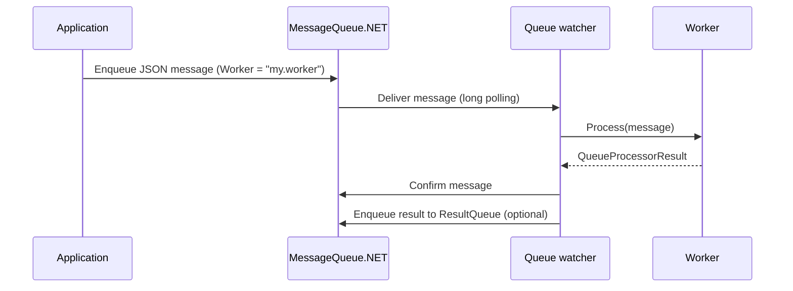

# Queue worker pattern

The queue worker pattern lets an application watch one or more queues and hand each message to a matching
**worker**. Messages are JSON objects; the field `Worker` decides which worker processes the message. A worker can
write its result to a *result queue*, where the next worker picks it up.



## Messages

Every message is based on `BaseQueueProcessorMessage`:

```csharp
public class BaseQueueProcessorMessage
{
    public string ProcessId { get; set; } = "";
    public string Worker { get; set; } = "";       // (1)!
    public string? ResultQueue { get; set; }      // (2)!
    public string? Publisher { get; set; }
    public string? Subject { get; set; }
}
```

1. The `WorkerId` of the worker that processes the message.
2. Optional: the result of the worker is written to this queue.

`GenericQueueProcessorMessage<T>` adds a typed `Body`.

## Workers

A worker implements `IQueueProcessor`:

```csharp
public interface IQueueProcessor
{
    string WorkerId { get; }
    bool ConfirmAlways { get; } // (1)!
}
```

1. `true`: the message is confirmed after processing, even if the worker fails.

There are two kinds of workers:

=== "Non-generic"

    ```csharp
    public interface INonGenericQueueProcessor : IQueueProcessor
    {
        Task<QueueProcessorResult> Process(
            BaseQueueProcessorMessage jobProcessMessage,
            CancellationToken cancellationToken);
    }
    ```

=== "Generic"

    ```csharp
    public interface IGenericQueueProcessor<T> : IQueueProcessor where T : new()
    {
        Task<QueueProcessorResult> ProcessGeneric(
            GenericQueueProcessorMessage<T> message,
            CancellationToken cancellationToken);
    }
    ```

## Setup

Register the client service and the queue watcher:

```csharp title="Program.cs"
using MessageQueueNET.Client.Extensions.DependencyInjetion;

builder.Services
    .AddMessageQueueClientService()
    .AddQueueProcessorWatcher(config =>
    {
        config.MessageQueueApiUrl = "https://localhost:5001";
        config.QueueNameFilter = "mq-processor.jobs"; // (1)!
    });
```

1. Single queue (`my-queue`), pattern (`my-queues.*`) or several patterns (`my-queues.*,our-queues.*`).

Further options: `MessageQueueClientId`, `MessageQueueClientSecret`, `MaxPollingSeconds` and `TryRegisterQueues`.

### Testing with the ping worker

`AddQueueProcessorWatcher` adds the `PingWorker` (`mq.ping`). It writes its result to
`ping.response.{ResultQueue}`. Test it with [mqnet](../tools.md#shell):

```text
mqnet https://localhost:5001 -c shell
>> mq-processor.jobs enqueue -ping -m 1
```


## Custom workers

Define a body model and, if needed, a result model:

```csharp
public class CommandLineWorkerMessage
{
    public string Command { get; set; } = "";
    public string Arguments { get; set; } = "";
}

public class CommandLineWorkerResultBody
{
    public int ExitCode { get; set; }
    public string? Output { get; set; }
    public string? ErrorOutput { get; set; }
}
```

Implement the worker:

```csharp title="CommandLineWorker.cs"
public class CommandLineWorker : IGenericQueueProcessor<CommandLineWorkerMessage>
{
    public const string WorkerIdentifier = "mq.commandline";

    public string WorkerId => WorkerIdentifier;

    public bool ConfirmAlways => true;

    public async Task<QueueProcessorResult> ProcessGeneric(
            GenericQueueProcessorMessage<CommandLineWorkerMessage> message,
            CancellationToken cancellationToken)
    {
        try
        {
            // business logic ...

            return new GenericQueueProcessorResult<CommandLineWorkerResultBody>() // (1)!
            {
                Worker = "mq-commandline.result.file",
                Body = new CommandLineWorkerResultBody()
                {
                    ExitCode = 0,
                    Output = "..."
                }
            };
        }
        catch (Exception ex)
        {
            return new QueueProcessorResult()
            {
                Succeeded = false,
                ErrorMessages = ex.ToString()
            };
        }
    }
}
```

1. If the message has a `ResultQueue`, this result is enqueued there as a message for the worker
   `mq-commandline.result.file`.

Register the worker:

```csharp title="Program.cs"
builder.Services.AddTransient<IQueueProcessor, CommandLineWorker>();
```

## Sending worker messages

Serialize the message and enqueue it with the [client](../client.md):

=== "Base message"

    ```csharp
    var message = new BaseQueueProcessorMessage()
    {
        ProcessId = Guid.NewGuid().ToString(),
        Worker = "mq.ping",
        ResultQueue = "mq-processor.jobs",  // optional
        Subject = "ping",                   // optional
        Publisher = Environment.UserName    // optional
    };

    await client.EnqueueAsync([JsonSerializer.Serialize(message)]);
    ```

=== "Generic message"

    ```csharp
    var message = new GenericQueueProcessorMessage<CommandLineWorkerMessage>()
    {
        ProcessId = Guid.NewGuid().ToString(),
        Worker = CommandLineWorker.WorkerIdentifier,
        ResultQueue = "mq-processor.jobs.results",
        Publisher = Environment.UserName,
        Body = new()
        {
            Command = @"c:\temp\test.bat",
            Arguments = "123"
        }
    };

    await client.EnqueueAsync([JsonSerializer.Serialize(message)]);
    ```
